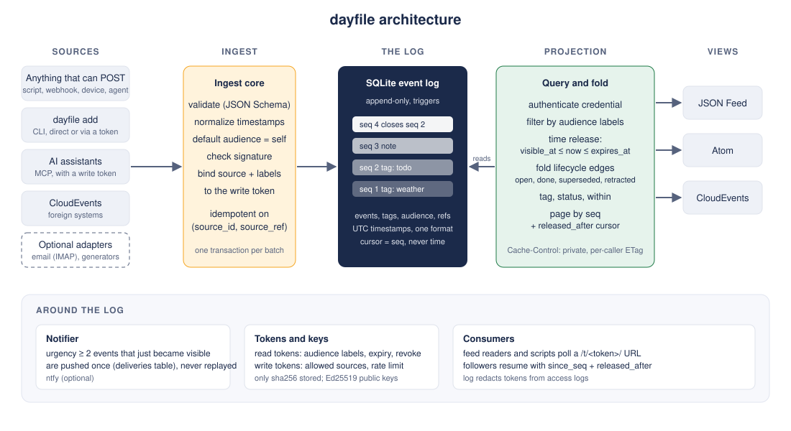
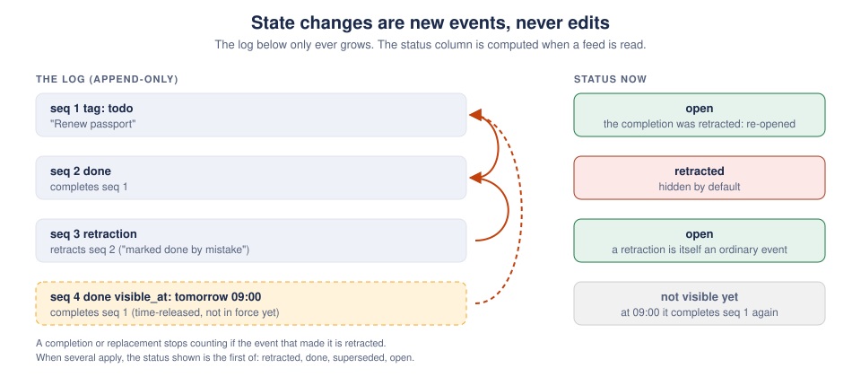
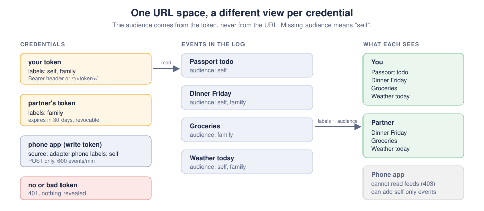

<p align="center"></p>

# dayfile

**[dayfile.app](https://dayfile.app)**: a personal, append-only event log, served as feeds (JSON Feed, Atom,
CloudEvents). Free beta: [see the demo](https://dayfile.app/demo), then sign in with GitHub and get your own log at
`<username>.dayfile.cloud`. Or self-host it: `pip install dayfile`, below.

Anything that can send an HTTP request can add events: a script, a webhook, a device, an AI assistant over MCP. The log
is the source of truth; feeds are projections of it, addressed by URL queries such as
`/feed.json?tag=todo&status=open&within=7d`. dayfile keeps the log, enforces who may write and read, and serves the
feeds and the API. Getting events into the right shape from other systems (email, SMS, cron jobs) is the job of whatever
posts them; the repo includes optional adapters for self-hosters.

- Append-only SQLite log, enforced by triggers. State changes are new events that point back at the original (close it, replace it, retract it); the status of an event is worked out from that chain.
- Time release (`visible_at`, `expires_at`), idempotent ingest, deny-by-default audiences.
- A JSON API (`GET /events`, long-poll, live SSE stream) next to the feeds, and an MCP server so assistants such as Claude can read and write the log.
- Per-credential feeds: read tokens (Bearer header or `/t/<token>/` path) and write-only tokens.
- Heartbeats: say how often a source should report and dayfile writes an open to-do when it goes quiet.
- A web app (`dayfile[web]`): sign in with GitHub, a log you can read and post to, tokens, feeds (private or public) and settings. It is what runs at [dayfile.app](https://dayfile.app); see below for what runs where.
- Ed25519 signed events and CloudEvents import/export.
- Optional adapters for self-hosters, not part of the hosted service: Gmail/Google Voice SMS ingest over IMAP, weather and digest generators, ntfy push.

Design: [docs/SPEC.md](https://github.com/dayfile/dayfile/blob/master/docs/SPEC.md). Milestones and status: [docs/ROADMAP.md](https://github.com/dayfile/dayfile/blob/master/docs/ROADMAP.md).
Contributor rules: [CLAUDE.md](https://github.com/dayfile/dayfile/blob/master/CLAUDE.md).

## How it fits together



State changes are new events, never edits:



One URL space, a different view per credential:



## Quick start

Requires Python 3.11 or newer.

```
pip install dayfile            # or: uv tool install dayfile  /  pipx install dayfile
export DAYFILE_DB=~/dayfile.db

dayfile add "buy milk" --tag todo --db "$DAYFILE_DB"     # write straight into the local log
dayfile token create --labels self                         # read token: prints the feed URLs once
dayfile token create --labels self --write-source adapter:cli   # write token, for remote clients
uvicorn dayfile.app:app                                    # serve on 127.0.0.1:8000
```

Open the feed URL that `token create` printed (`http://127.0.0.1:8000/t/<read token>/feed.json`, or
`feed.atom`) in a browser or a feed reader. Add events from another machine with
`DAYFILE_WRITE_TOKEN=<write token> dayfile --url http://127.0.0.1:8000 add "buy milk" --tag todo`.
For a server that stays up, use Docker or systemd: [`deploy/selfhost`](https://github.com/dayfile/dayfile/blob/master/deploy/selfhost).

Extras: `pip install "dayfile[mcp]"` for the assistant (MCP) server, `"dayfile[web]"` for the dayfile.app web app.

## Feed URLs

A feed URL answers two questions: **which view** of the log, and **who is asking**.

| Path | Meaning | Example |
|---|---|---|
| `/feed.json`, `/feed.atom` | the default feed: the whole log, filtered by query parameters | `/feed.json?tag=todo&status=open` |
| `/f/<feed>.json`, `.atom` | a **named feed**: a saved filter (tags, status, time window) with a fixed meaning | `/f/todo-open.atom` |
| `/t/<token>/...` | the same feeds, with a **read token in the path**, for feed readers that cannot send headers | `/t/<token>/f/todo-open.atom` |

- Programs should send the token as `Authorization: Bearer <token>` and leave `/t/<token>` out; the path form is a compatibility layer.
- The token decides what you may see (its audience labels), and it can expire or be revoked. Treat a URL that contains one as a secret.
- A named feed is `private` unless you make it `public`. Anyone can read a public feed without a token, but only the events whose audience includes `public`.
- Create and manage named feeds and tokens in the web app (Feeds, Tokens) or with the CLI. The full list of endpoints is on the [docs page](https://dayfile.app/docs) and in [docs/SPEC.md](https://github.com/dayfile/dayfile/blob/master/docs/SPEC.md).

## JSON API

```
curl -H "Authorization: Bearer $READ_TOKEN" 'http://127.0.0.1:8000/events?tag=todo&status=open'
curl -H "Authorization: Bearer $READ_TOKEN" 'http://127.0.0.1:8000/events?since_seq=42&wait=25'   # long-poll
curl -N -H "Authorization: Bearer $READ_TOKEN" http://127.0.0.1:8000/events/stream               # live, SSE
curl -H "Authorization: Bearer $WRITE_TOKEN" -d @event.json -H 'content-type: application/json' http://127.0.0.1:8000/events
```

See the JSON API section of [docs/SPEC.md](https://github.com/dayfile/dayfile/blob/master/docs/SPEC.md).

## Commands

| Command | Purpose |
|---|---|
| `dayfile add` | append an event: with `--db PATH` straight into the database (operator mode), otherwise POST to `--url` using a write token in `$DAYFILE_WRITE_TOKEN` |
| `dayfile token create\|list\|revoke` | manage read and write tokens |
| `dayfile poll-email` | ingest a Gmail folder (default `SMS`) using `GMAIL_USER` / `GMAIL_APP_PASSWORD` from env or `.env` |
| `dayfile notify` | publish urgent events to ntfy (`$NTFY_URL`) as they become visible |
| `dayfile gen weather\|digest` | generators that write ordinary events back to the log |
| `dayfile key create\|list\|import` | signing keys (`add --sign`) |
| `dayfile mcp` | MCP server on stdio for AI assistants (`pip install dayfile[mcp]`); see below |
| `dayfile backup DEST` | consistent online copy of the database |
| `dayfile tenant ...` | managed-service operations: create, suspend, limit, usage (see [docs/CLOUD.md](https://github.com/dayfile/dayfile/blob/master/docs/CLOUD.md)) |

## MCP server

Let an assistant such as Claude read and write your log. Both ways use the same five tools (`dayfile_list_events`, `dayfile_get_event`, `dayfile_add_event`, `dayfile_close_todo`, `dayfile_retract_event`) and can do only what their tokens allow.

**Hosted (dayfile.cloud).** Every log has an MCP address, `https://<username>.dayfile.cloud/mcp`. In Claude, open Customize, then Connectors, then Add custom connector, paste that address and press Connect: you sign in with GitHub and choose read and write or read only. Claude Code can use it too: `claude mcp add --transport http dayfile https://<username>.dayfile.cloud/mcp`, then `/mcp` to sign in. To skip the sign-in, send a read token and a write token joined with `~` as `Authorization: Bearer <read>~<write>` (read only: the read token alone). Disconnect any time under Tokens.

**Local, over stdio.** `dayfile mcp` (`pip install "dayfile[mcp]"`) calls the API at `$DAYFILE_URL` with a read token in `$DAYFILE_READ_TOKEN` and a write token in `$DAYFILE_WRITE_TOKEN`; leave the write token out for a read-only assistant. This is the way to use a self-hosted server without OAuth.

```json
{"mcpServers": {"dayfile": {
  "command": "uvx", "args": ["--from", "dayfile[mcp]", "dayfile", "mcp"],
  "env": {"DAYFILE_URL": "https://myname.dayfile.cloud",
          "DAYFILE_READ_TOKEN": "...", "DAYFILE_WRITE_TOKEN": "..."}}}}
```

Self-hosting the hosted endpoint: set `DAYFILE_MCP=1` (needs `dayfile[mcp]`) and, to offer the sign-in button, `DAYFILE_OAUTH_ISSUER` to the address of a dayfile web app that has accounts.

## Two ways to run it

**Hosted:** [dayfile.app](https://dayfile.app), nothing to run: your log, feeds, tokens and MCP endpoint at `<username>.dayfile.cloud`.
**Self-hosted:** your own server. The same code serves both; the difference is configuration.

| | Self-hosted ([`deploy/selfhost`](https://github.com/dayfile/dayfile/blob/master/deploy/selfhost)) | Managed-service profile ([`deploy/cloud`](https://github.com/dayfile/dayfile/blob/master/deploy/cloud)) |
|---|---|---|
| Logs | one, in `$DAYFILE_DB` | one SQLite file per tenant at `<slug>.<your-domain>` |
| Setup | `docker compose up` or systemd | same image with `DAYFILE_TENANTS_DIR` + `DAYFILE_BASE_DOMAIN` |
| Extras | none | suspension, quotas, per-tenant limits, tenant backups, Litestream, on-demand TLS |

The web app (`src/dayfile/web`, install with `pip install "dayfile[web]"`) is a separate process that talks to the API over HTTP and has no access to tenant files. Accounts, GitHub sign-in, invite codes and the dashboard need the cloud profile (they create tenants through an admin API); the self-hosted profile runs the API, CLI and feeds, and the web app is not part of its compose file yet. Billing is not built. [docs/CLOUD.md](https://github.com/dayfile/dayfile/blob/master/docs/CLOUD.md) describes the hooks.

## Security notes

- Keep the server on localhost or behind a trusted TLS proxy; tokens in URL paths are a compatibility layer for feed readers.
- Only token hashes are stored; token values are redacted from logs. `.env` is gitignored.

## Contributing

Want to change dayfile itself? Setup, tests and the rules for changes are in [CONTRIBUTING.md](https://github.com/dayfile/dayfile/blob/master/CONTRIBUTING.md).

## License

dayfile is free software under the [GNU Affero General Public License v3](https://github.com/dayfile/dayfile/blob/master/LICENSE) (AGPL-3.0-only).
You may use, modify and self-host it freely. If you run a modified version as a network service,
section 13 requires you to offer its users the corresponding source code.
